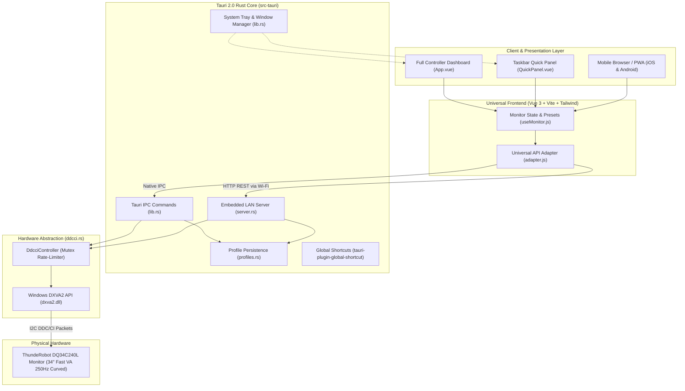

# Contributing to ThundeRobot Monitor Control

First off, thank you for considering contributing to the **ThundeRobot DQ34C240L Monitor Control Suite**! Projects like this thrive because of community contributions, whether you're adding support for new monitor models, fixing bugs, improving the UI, or writing documentation.

---

## Table of Contents

- [Code of Conduct](#code-of-conduct)
- [Architecture Overview](#architecture-overview)
- [Development Environment Setup](#development-environment-setup)
- [Project Structure](#project-structure)
- [Development Workflows](#development-workflows)
  - [Working on the Vue 3 Frontend](#1-working-on-the-vue-3-frontend)
  - [Working on the Tauri 2.0 Desktop App](#2-working-on-the-tauri-20-desktop-app)
  - [Working on the Embedded Phone Remote Server](#3-working-on-the-embedded-phone-remote-server)
  - [Adding or Modifying DDC/CI Features](#4-adding-or-modifying-ddcci-features)
- [Coding & Commit Guidelines](#coding--commit-guidelines)
- [Building & Packaging Releases](#building--packaging-releases)
- [Submitting a Pull Request](#submitting-a-pull-request)

---

## Code of Conduct

This project is open-source and welcoming to everyone. Please be respectful, constructive, and kind in all issues, pull requests, and discussions.

---

## Architecture Overview

The application is engineered as a **hybrid native desktop and LAN web application**:
- **Desktop (Native)**: Built with **Tauri 2.0 (Rust)** for direct Windows DXVA2 hardware access, system tray integration, and low memory usage (~40 MB).
- **Frontend**: Built with **Vue.js 3 (Composition API)**, **Vite**, and **Tailwind CSS** (shadcn-vue Zinc Dark aesthetic).
- **Mobile Remote**: A lightweight multi-threaded HTTP server (`tiny_http` + `rust-embed`) is embedded directly into the native binary, serving the web UI and REST API to any phone over local Wi-Fi without needing external runtimes.



---

## Development Environment Setup

### Prerequisites

1. **Operating System**: Windows 10/11 (x64) is required for native DDC/CI communication via `dxva2.dll`.
2. **Node.js**: Version 18.x or higher (with `npm`).
3. **Rust Toolchain**: Stable toolchain installed via [rustup.rs](https://rustup.rs/).
4. **C++ Build Tools**: Visual Studio 2022 / Community with **Desktop development with C++** workload installed.
5. **Git**: Installed and configured on your machine.

### Initial Clone & Installation

```powershell
# 1. Clone repository
git clone https://github.com/samiulislamsharan/thunderobot-monitor-control.git
cd thunderobot-monitor-control

# 2. Install root and frontend dependencies
npm install
npm --prefix frontend install
```

---

## Project Structure

```
thunderobot-monitor-control/
├── frontend/                     # Vue 3 + Tailwind CSS User Interface
│   ├── src/
│   │   ├── api/
│   │   │   └── adapter.js        # Universal bridge: Tauri IPC vs REST fetch
│   │   ├── components/
│   │   │   ├── QuickPanel.vue    # Taskbar tray popup window
│   │   │   ├── Header.vue        # Telemetry, monitor badge, phone QR modal trigger
│   │   │   ├── PictureControls.vue # Brightness, contrast & picture modes
│   │   │   ├── ColorControls.vue # Color temps & RGB gain sliders
│   │   │   ├── GamingControls.vue # Overdrive (0-5), sharpness & MPRT strobe
│   │   │   ├── PresetsBar.vue    # Factory presets & custom profile selector
│   │   │   └── PhonePairModal.vue# QR code pairing generator for mobile
│   │   ├── composables/
│   │   │   └── useMonitor.js     # Reactive monitor state & debounced updates
│   │   ├── App.vue               # Mode coordinator (main dashboard vs quickpanel)
│   │   └── style.css             # Tailwind dark theme & custom slider styles
│   └── dist/                     # Production build artifacts embedded into Rust
│
├── src-tauri/                    # Native Rust Backend (Tauri 2.0)
│   ├── src/
│   │   ├── ddcci.rs              # Win32 DXVA2 ctypes/FFI engine with safe rate-limiting
│   │   ├── server.rs             # Embedded tiny_http LAN server + rust-embed
│   │   ├── profiles.rs           # Factory & custom profile JSON persistence
│   │   ├── settings.rs           # Hotkey validation & app configuration
│   │   ├── lib.rs                # Tauri IPC handlers, tray setup & window manager
│   │   └── main.rs               # Windows application entry point
│   ├── icons/                    # Multi-resolution ThundeRobot branding assets
│   ├── tauri.conf.json           # Dual-window configuration & bundle settings
│   └── Cargo.toml                # Rust dependencies & metadata
│
├── backend/                      # Optional Python FastAPI backend (legacy/web mode)
│   ├── ddcci.py                  # Python ctypes DDC/CI implementation
│   ├── main.py                   # FastAPI routes & static file server
│   └── monitor_detector.py       # EDID & LAN IP resolution
│
├── .github/                      # CI/CD Workflows & Release Automations
├── CONTRIBUTING.md               # Contribution guidelines (this file)
└── README.md                     # Main documentation & user guide
```

---

## Development Workflows

### 1. Working on the Vue 3 Frontend

You can test the UI in the browser without compiling Rust:

```powershell
# Run Vite dev server with hot-module replacement
npm run dev
```

*Note: In plain browser mode, the UI talks to the REST API via [`frontend/src/api/adapter.js`](file:///H:/GitHub/thunderobot-monitor-control/frontend/src/api/adapter.js).*

### 2. Working on the Tauri 2.0 Desktop App

To develop and test the native desktop application with live reload:

```powershell
npm run tauri:dev
```

This launches the Vite dev server and mounts the native Windows webview with Tauri IPC enabled.

### 3. Working on the Embedded Phone Remote Server

The embedded server ([`src-tauri/src/server.rs`](file:///H:/GitHub/thunderobot-monitor-control/src-tauri/src/server.rs)) serves both static web assets (via `rust-embed`) and REST API endpoints.

To test changes to the embedded server:
1. Rebuild the frontend bundle:
   ```powershell
   npm --prefix frontend run build
   ```
2. Run or test the Rust backend:
   ```powershell
   cargo check --manifest-path src-tauri/Cargo.toml
   cargo test --manifest-path src-tauri/Cargo.toml
   ```

### 4. Adding or Modifying DDC/CI Features

To expose a new monitor feature:
1. **Map the VCP Opcode**: Add the VCP code to [`src-tauri/src/lib.rs`](file:///H:/GitHub/thunderobot-monitor-control/src-tauri/src/lib.rs) inside `resolve_feature_code()` and `get_features()`.
2. **Add to Embedded REST Server**: In [`src-tauri/src/server.rs`](file:///H:/GitHub/thunderobot-monitor-control/src-tauri/src/server.rs), ensure `handle_api()` reads and sets the feature.
3. **Update Frontend Composable**: Add reactive state and setter functions to [`frontend/src/composables/useMonitor.js`](file:///H:/GitHub/thunderobot-monitor-control/frontend/src/composables/useMonitor.js).
4. **Create or Update UI Component**: Add controls in the relevant component under `frontend/src/components/`.

---

## Coding & Commit Guidelines

### Conventional Commits

We strictly follow the [Conventional Commits](https://www.conventionalcommits.org/) specification:

```
<type>[optional scope]: <description>

[optional body]
```

#### Allowed Types:
- **`feat`**: A new feature (e.g. `feat(tray): add mouse wheel slider control`)
- **`fix`**: A bug fix (e.g. `fix(ipc): correct parameter name mapping`)
- **`docs`**: Documentation only changes
- **`style`**: Code formatting, missing semicolons, etc. (no logic change)
- **`refactor`**: Refactoring code without changing behavior
- **`perf`**: Performance improvement
- **`test`**: Adding or correcting tests
- **`chore`**: Changes to build tools, dependencies, or version bumps

---

## Building & Packaging Releases

To build production installers and standalone binaries:

```powershell
# Build production frontend and bundle installers
npm run tauri:build
```

Build outputs will be generated in `src-tauri/target/release/bundle/`:
- **NSIS Installer**: `thunderobot-monitor-control_<version>_x64-setup.exe`
- **MSI Installer**: `thunderobot-monitor-control_<version>_x64_en-US.msi`
- **Portable Binary**: `src-tauri/target/release/thunderobot-monitor-control.exe`

---

## Submitting a Pull Request

1. **Fork the repository** on GitHub.
2. **Create a topic branch**:
   ```powershell
   git checkout -b feat/your-feature-name
   ```
3. **Commit your changes** following Conventional Commits.
4. **Ensure clean compilation**:
   ```powershell
   cargo check --manifest-path src-tauri/Cargo.toml
   npm --prefix frontend run build
   ```
5. **Push to your fork** and open a Pull Request against `main`.
6. Provide a clear description of the problem solved and test steps performed.
