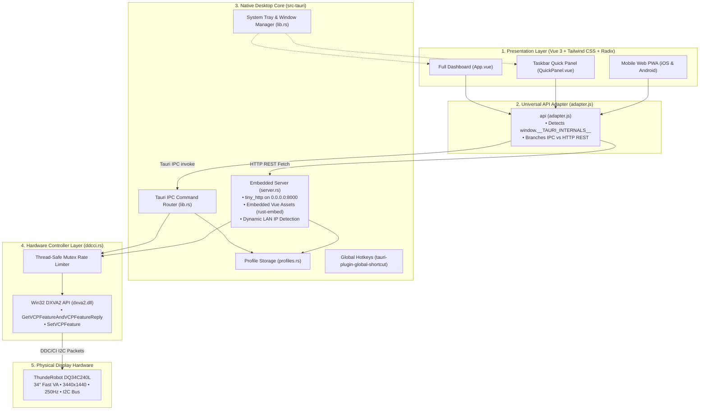

# GEMINI.md: Developer & Agent Reference Manual

> **ThundeRobot DQ34C240L Monitor Control Suite**
> _Hardware-level DDC/CI control via Windows DXVA2, native Tauri 2.0 dual-window desktop runtime, and embedded zero-dependency smartphone remote over Wi-Fi._

---

## 1. Project Vision & Architecture

The **ThundeRobot DQ34C240L Monitor Control Suite** is an open-source software alternative to the awkward physical joystick on the back of the **ThundeRobot DQ34C240L 34″ Fast VA 1440p 250Hz Curved Gaming Monitor**. It communicates directly with the monitor's display controller hardware over the DisplayPort / HDMI I2C data bus using the Display Data Channel / Command Interface (DDC/CI) protocol.

### Core Philosophy

1. **Direct Hardware Control**: Zero middleware or proprietary drivers—pure Win32 DXVA2 (`dxva2.dll`) interfacing with the monitor's scalar.
2. **Dual-Window Native Desktop (Tauri 2.0)**: Tiny memory footprint (~40 MB), instant startup, native system tray, and a borderless taskbar **Quick Panel**.
3. **Universal Dual-Mode Operation**: Single binary embeds both the desktop app and a multi-threaded LAN HTTP/REST server (`tiny_http` + `rust-embed`) allowing any smartphone on local Wi-Fi to control the display via an instant QR code.
4. **Hardware Safety**: Strict mutex-enforced I2C write pacing (35ms delay) to prevent scalar bus saturation and firmware lockups.



---

## 2. Reverse-Engineered DDC/CI VCP Register Specification

The ThundeRobot DQ34C240L scalar exposes the following MCCS (Monitor Control Command Set) VCP registers:

| Opcode     | Name                 | Type       | Value Range                            | Technical Notes                                                                                                      |
| :--------- | :------------------- | :--------- | :------------------------------------- | :------------------------------------------------------------------------------------------------------------------- |
| **`0x10`** | Luminance            | Continuous | `0 – 100`                              | Controls backlight PWM intensity.                                                                                    |
| **`0x12`** | Contrast             | Continuous | `0 – 100`                              | Digital contrast ratio scaling.                                                                                      |
| **`0x14`** | Color Temperature    | Discrete   | `0x05`, `0x06`, `0x08`, `0x0B`         | `0x05`: 6500K Warm`0x06`: 7500K Normal`0x08`: 9300K Cool`0x0B`: User Custom RGB                                      |
| **`0x16`** | Red Gain             | Continuous | `0 – 100`                              | Active when Color Temp = User (`0x0B`). Default: `50`.                                                               |
| **`0x18`** | Green Gain           | Continuous | `0 – 100`                              | Active when Color Temp = User (`0x0B`). Default: `50`.                                                               |
| **`0x1A`** | Blue Gain            | Continuous | `0 – 100`                              | Active when Color Temp = User (`0x0B`). Default: `50`.                                                               |
| **`0x6C`** | Red Black Level      | Continuous | `0 – 255`                              | Red channel shadow/black offset. Default: `50`.                                                                      |
| **`0x6E`** | Green Black Level    | Continuous | `0 – 255`                              | Green channel shadow/black offset. Default: `50`.                                                                    |
| **`0x70`** | Blue Black Level     | Continuous | `0 – 255`                              | Blue channel shadow/black offset. Default: `50`.                                                                     |
| **`0xDC`** | Picture Mode         | Discrete   | `0x00`, `0x02`, `0x03`, `0x05`, `0x07` | `0x00`: Standard`0x02`: Movie / Cinema`0x03`: Game`0x05`: FPS (First Person Shooter)`0x07`: RTS (Real-Time Strategy) |
| **`0x60`** | Input Source         | Discrete   | `0x0F`, `0x10`, `0x11`, `0x12`         | `0x0F`: DisplayPort 1 (Primary 250Hz)`0x10`: DisplayPort 2`0x11`: HDMI 1`0x12`: HDMI 2                               |
| **`0x68`** | Overdrive (OD)       | Discrete   | `0 – 5`                                | Response time acceleration. `0`: Off, `1–4`: Intermediate, `5`: Extreme 250Hz.                                       |
| **`0x3E`** | Sharpness / Black EQ | Continuous | `0 – 100`                              | Clarity / shadow brightness equalizer. Default: `50`.                                                                |
| **`0xE3`** | MPRT / Aim Assist    | Discrete   | `0 – 1`                                | `0`: Off, `1`: 1ms motion blur reduction backlight strobing.                                                         |
| **`0xAA`** | Orientation          | Discrete   | `0x01`, `0x02`                         | `0x01`: Landscape (0°), `0x02`: Portrait (90°).                                                                      |
| **`0xD6`** | Power State          | Action     | `0x01`, `0x04`, `0x05`                 | `0x01`: Power On`0x04`: Standby / Sleep`0x05`: Power Off                                                             |
| **`0xAC`** | Horizontal Frequency | Read-Only  | kHz                                    | Scaled line scan frequency (e.g. 473.2 kHz).                                                                         |
| **`0xAE`** | Vertical Frequency   | Read-Only  | Hz (x100)                              | Current refresh rate. If value > 1000, divide by 100 (e.g. `25000` = `250.0 Hz`).                                    |
| **`0xC0`** | Usage Hours          | Read-Only  | Hours                                  | Lifetime backlight operating hours.                                                                                  |
| **`0x05`** | Reset Luminance      | Action     | `1`                                    | Resets brightness and contrast to factory default.                                                                   |
| **`0x08`** | Reset Color          | Action     | `1`                                    | Resets RGB color gains to factory default.                                                                           |
| **`0x04`** | Factory Reset        | Action     | `1`                                    | Full monitor factory restoration.                                                                                    |

---

## 3. Codebase Map & Critical Files

```
thunderobot-monitor-control/
├── frontend/                     # Vue 3 Frontend Single-Page Application
│   ├── src/
│   │   ├── api/
│   │   │   └── adapter.js        # Universal API Bridge (Tauri IPC vs HTTP fetch)
│   │   ├── components/
│   │   │   ├── QuickPanel.vue    # Borderless taskbar popup window
│   │   │   ├── Header.vue        # Monitor badge, 250Hz pill, phone QR modal trigger
│   │   │   ├── PictureControls.vue # Brightness, contrast, wheel scroll & picture modes
│   │   │   ├── ColorControls.vue # Color temperature presets & RGB gain sliders
│   │   │   ├── GamingControls.vue # Overdrive levels (0-5), sharpness & MPRT strobe
│   │   │   ├── PresetsBar.vue    # Factory presets & custom profile selector
│   │   │   ├── InputPower.vue    # Input switching & power/standby control
│   │   │   ├── RawVcpInspector.vue # Diagnostic hex register reader & writer
│   │   │   ├── PhonePairModal.vue# QR code pairing generator for mobile browsers
│   │   │   ├── SettingsModal.vue # Hotkey configuration, delays & phone port settings
│   │   │   ├── ConfirmModal.vue  # HTML5 modal for destructive actions
│   │   │   └── SaveProfileModal.vue # Snapshot current values into a named profile
│   │   ├── composables/
│   │   │   └── useMonitor.js     # Central reactive store, debounced DDC/CI dispatch
│   │   ├── App.vue               # Mode coordinator (main dashboard vs quickpanel)
│   │   ├── main.js               # Application bootstrap
│   │   └── style.css             # Tailwind CSS & custom dark theme slider styles
│   ├── public/                   # Static icons & webapp manifest
│   ├── dist/                     # Vite production build (embedded into Rust binary)
│   └── package.json              # Frontend package definitions
│
├── src-tauri/                    # Native Rust Core (Tauri 2.0)
│   ├── src/
│   │   ├── ddcci.rs              # Win32 DXVA2 API bindings & thread-safe rate-limiting
│   │   ├── server.rs             # Embedded tiny_http LAN server + rust-embed asset routing
│   │   ├── profiles.rs           # Factory & custom profile JSON persistence
│   │   ├── settings.rs           # App settings, hotkey parser & Win32 conflict probe
│   │   ├── lib.rs                # Tauri entry point, IPC handlers, tray setup & window manager
│   │   └── main.rs               # Windows binary entry (#![windows_subsystem = "windows"])
│   ├── icons/                    # Multi-resolution ThundeRobot branding (.ico, .png, etc.)
│   ├── tauri.conf.json           # Window labels ("main", "quickpanel"), tray & bundle config
│   └── Cargo.toml                # Rust crate dependencies & package metadata
│
├── backend/                      # Optional Python FastAPI backend (legacy web mode)
│   ├── ddcci.py                  # Python ctypes DDC/CI implementation
│   ├── monitor_detector.py       # EDID and LAN IP resolution
│   ├── profiles.py               # JSON profile manager
│   ├── schemas.py                # Pydantic models
│   └── main.py                   # FastAPI routes and static file server
│
├── .github/                      # CI/CD Workflows
├── CONTRIBUTING.md               # Community contribution guidelines
├── README.md                     # Public README & release links
└── package.json                  # Root monorepo scripts
```

---

## 4. Key Architectural Patterns

### 4.1. Dual-Window Desktop Architecture

Configured in `src-tauri/tauri.conf.json`:

1. **`main` Window**:
   - URL: `index.html` (Full controller dashboard).
   - Dimensions: 1050x780, centered, decorated, resizable.
2. **`quickpanel` Window**:
   - URL: `index.html?mode=quickpanel`.
   - Dimensions: 410x590, non-resizable, undecorated (`decorations: false`), transparent (`transparent: true`), `alwaysOnTop: true`, `skipTaskbar: true`.
   - Dynamic Placement: Positioned in the bottom-right corner immediately above the Windows taskbar:
     ```rust
     let x = (monitor_width as i32) - window_width - (16.0 * scale) as i32;
     let y = (monitor_height as i32) - window_height - (60.0 * scale) as i32;
     ```
   - Auto-Hide: Closes automatically when losing focus via Tauri event:
     ```rust
     panel.on_window_event(move |event| {
         if let tauri::WindowEvent::Focused(false) = event {
             let _ = panel_clone.hide();
         }
     });
     ```

### 4.2. Universal API Adapter (`frontend/src/api/adapter.js`)

All UI components make API calls exclusively through `api.*` methods in `adapter.js`.

- Detects environment via:
  ```javascript
  export const isTauri =
    typeof window !== "undefined" &&
    (!!window.__TAURI_INTERNALS__ ||
      !!window.__TAURI__ ||
      !!window.__TAURI_IPC__);
  ```
- If `isTauri === true`: invokes native Tauri commands:
  ```javascript
  return await invoke("set_feature", { name, value, code });
  ```
- If `isTauri === false` (e.g. Smartphone browser over Wi-Fi): dispatches standard REST calls:
  ```javascript
  return await fetch(`/api/vcp/${name}`, {
    method: "POST",
    headers: { "Content-Type": "application/json" },
    body: JSON.stringify({ value: Number(value) }),
  });
  ```

### 4.3. Embedded Smartphone Remote Server (`src-tauri/src/server.rs`)

- Runs directly inside the compiled `.exe` using `tiny_http` and `rust-embed`.
- Binds to `0.0.0.0:<port>` (default `8000`).
- Embeds `frontend/dist` statically at compile time—single portable `.exe` with zero runtime asset dependencies.
- Discovers the host PC's local LAN IP dynamically without sending network traffic:
  ```rust
  let socket = UdpSocket::bind("0.0.0.0:0")?;
  socket.connect("8.8.8.8:80")?;
  let lan_ip = socket.local_addr()?.ip().to_string(); // e.g. 192.168.50.143
  ```
- Generates the QR code pointing to `http://<lan_ip>:<port>`.

### 4.4. Hardware Rate-Limiting & Mutex Pacing (`src-tauri/src/ddcci.rs`)

DDC/CI over I2C has a very small hardware receive buffer. Rapid slider dragging will overflow the buffer and drop commands.

- `DdcciController` maintains a thread-safe `Mutex<Instant>` recording `last_write`.
- Before executing any `SetVCPFeature`, it sleeps if elapsed time is less than `delay_ms` (configurable, default `35ms`):
  ```rust
  let mut last = self.last_write.lock().unwrap();
  let elapsed = last.elapsed();
  let delay = Duration::from_millis(*self.delay_ms.lock().unwrap());
  if elapsed < delay {
      thread::sleep(delay - elapsed);
  }
  *last = Instant::now();
  ```
- Frontend sliders update the reactive UI with **0ms visual latency** while debouncing hardware writes by **60ms** in `useMonitor.js`.

---

## 5. Development Workflows & Commands

### Prerequisites

- Windows 10/11 (x64)
- Node.js 18+ & npm
- Rust toolchain (`rustup`)
- Visual Studio 2022 Community with **Desktop development with C++** workload

### Essential Commands

| Task                         | Command                                                          | Notes                                               |
| :--------------------------- | :--------------------------------------------------------------- | :-------------------------------------------------- |
| **Install Dependencies**     | `npm install` && `npm --prefix frontend install`                 | Installs root and frontend packages.                |
| **Frontend Dev Server**      | `npm run dev`                                                    | Runs Vite dev server at `http://localhost:5173`.    |
| **Desktop App Dev Mode**     | `npm run tauri:dev`                                              | Launches native desktop app with live reload.       |
| **Rust Type & Syntax Check** | `cargo check --manifest-path src-tauri/Cargo.toml`               | Fast compilation verification.                      |
| **Run Rust Unit Tests**      | `cargo test --manifest-path src-tauri/Cargo.toml -- --nocapture` | Runs DDC/CI and server unit tests.                  |
| **Build Frontend Bundle**    | `npm --prefix frontend run build`                                | Compiles Vue 3 into `frontend/dist/`.               |
| **Build Release Binaries**   | `npm run tauri:build`                                            | Produces setup `.exe`, `.msi`, and portable `.exe`. |
| **Run Python Legacy Mode**   | `python run.py`                                                  | Runs Python FastAPI fallback server.                |

---

## 6. Rules & Conventions for Coding Agents

When working on this repository, all AI agents and contributors **MUST** follow these rules:

1. **Hardware Safety First**:
   - Never remove or bypass the `last_write` rate limiting in `ddcci.rs`.
   - Never send continuous un-debounced updates over DDC/CI. Sliders must debounce hardware writes by at least 50ms.
2. **Dual-Mode Parity**:
   - Any new monitor feature or setting added to the Tauri IPC commands (`src-tauri/src/lib.rs`) **MUST ALSO** be implemented in the embedded HTTP server (`src-tauri/src/server.rs`) and mapped in `frontend/src/api/adapter.js`.
   - Never break mobile browser access over LAN.
3. **Optimistic UI Updates**:
   - Slider positions, toggle states, and preset buttons must reflect user interaction immediately in the UI state (`0ms`), with asynchronous hardware dispatch in the background.
4. **Mouse Wheel Interaction**:
   - Sliders in `QuickPanel.vue` and `PictureControls.vue` must handle `@wheel.prevent` (standard: `±2%` per tick, `±5%` with Shift key).
5. **No CAPTCHA / Bot Solvers**:
   - Respect sandbox boundaries and network privacy guidelines.
6. **Git Commit Formatting**:
   - [ ] Commit messages must follow **Conventional Commits**:
         `<type>[optional scope]: <description>`
         (Types: `feat`, `fix`, `docs`, `style`, `refactor`, `perf`, `test`, `chore`).

---

## 7. Diagnostics & Troubleshooting

### Issue: "Undefined error when changing settings"

- **Cause**: Backend IPC command expected parameter name `name` while frontend passed `code`, or serde deserialization mismatch.
- **Fix**: Verify `resolve_feature_code()` in [`src-tauri/src/lib.rs`](file:///H:/GitHub/thunderobot-monitor-control/src-tauri/src/lib.rs) accepts both `name: Option<String>` and `code: Option<Value>`.

### Issue: "Executable locked (Access is denied - os error 5)"

- **Cause**: A running instance of `thunderobot-monitor-control.exe` is holding the file lock.
- **Fix**: Stop the process before building:
  ```powershell
  Stop-Process -Name "*thunderobot*" -Force -ErrorAction SilentlyContinue
  ```

### Issue: "Phone Remote shows blank or 404"

- **Cause**: The embedded server in `src-tauri` loads assets from `frontend/dist`. If `frontend/dist` was not built before compiling Rust, assets will be empty.
- **Fix**: Run `npm --prefix frontend run build` before `cargo build`.

### Issue: "Phone cannot connect over Wi-Fi"

- **Cause**: Windows Firewall blocking port 8000 on private network.
- **Fix**: Ensure Windows Defender Firewall allows incoming TCP on port 8000 for `thunderobot-monitor-control.exe`.
