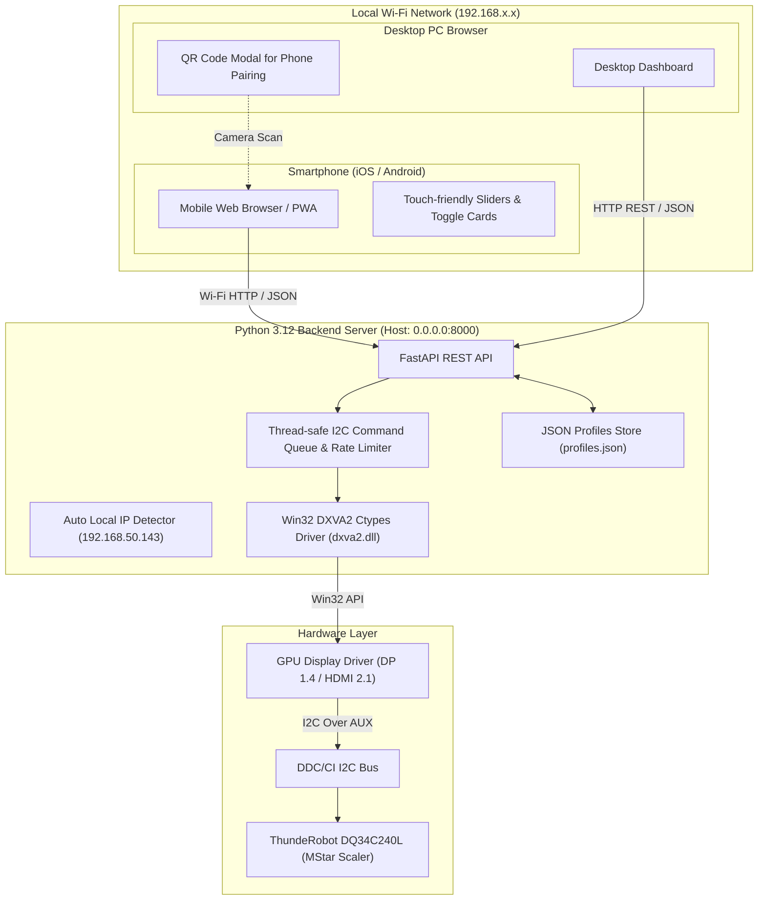

# Implementation Plan: ThundeRobot DQ34C240L DDC/CI Web Control Suite (Vue.js 3 Edition)

## Goal Description
Build a complete, end-to-end web application that gives the user full software control over their **ThundeRobot DQ34C240L 34″ Fast VA 1440p 250Hz Curved Gaming Monitor** via DDC/CI (Display Data Channel / Command Interface). This completely replaces the awkward physical joystick OSD button with a modern, responsive, cyber-aesthetic browser interface accessible from desktop and local network devices (e.g. smartphone or tablet).

Per user request, the frontend is built with **Vue.js 3** (Composition API `<script setup>`) + **Vite** + **Tailwind CSS** + **Lucide Vue Next**, with seamless **Mobile Phone Access** via LAN, automatic QR code pairing, and touch-optimized responsive controls.

---

## User Review Required

> [!IMPORTANT]
> **Mobile Phone LAN Access & Network Binding**:
> 1. The backend server automatically binds to `0.0.0.0:8000` instead of `127.0.0.1` so that any smartphone connected to the same Wi-Fi router can access it.
> 2. On first launch, Windows Defender Firewall may display a one-time prompt: **"Allow Python to communicate on Private networks"**. Click **Allow access**.
> 3. The server automatically detects your local LAN IP (e.g., `192.168.50.143`) and prints both the desktop URL and mobile URL in the console.
> 4. In the Web UI header on your desktop, a **"📱 Phone Remote"** button displays a scannable **QR Code** on the monitor screen. Pointing your phone camera at it instantly opens the remote control app.
> 5. **PWA Support**: The web app includes a Web Manifest and touch viewport headers so you can tap **"Add to Home Screen"** on iOS Safari or Android Chrome for a full-screen, app-like experience.

---

## Reverse-Engineered DDC/CI VCP Map for ThundeRobot DQ34C240L

Through active hardware probing on your system, the monitor was positively identified via EDID:
- **Device ID**: `TRG3402\...\UID0` -> **Model**: `DQ34C240L`
- **Scaler Chipset**: MStar (`MStarcmds(01 02 03 07 0C E3 F3)`)
- **Protocol**: MCCS 2.1 (`mccs_ver(2.1)`)
- **Total Responsive VCP Codes**: 43 codes detected

### Primary Mapped Controls

| VCP Code | Function / Name | Range / Values | Type | Description |
|---|---|---|---|---|
| **0x10** | Luminance (Brightness) | 0 - 100 | Slider | Backlight brightness |
| **0x12** | Contrast | 0 - 100 | Slider | Digital contrast ratio |
| **0x14** | Color Temperature Preset | `0x05`, `0x06`, `0x08`, `0x0B` | Select | `0x05`: 6500K (Warm)<br>`0x06`: 7500K (Normal)<br>`0x08`: 9300K (Cool)<br>`0x0B`: User / Custom RGB |
| **0x16** | Red Gain | 0 - 100 | Slider | Red channel multiplier |
| **0x18** | Green Gain | 0 - 100 | Slider | Green channel multiplier |
| **0x1A** | Blue Gain | 0 - 100 | Slider | Blue channel multiplier |
| **0x6C** | Red Black Level / Shadow Tuning | 0 - 255 | Slider | Red black offset |
| **0x6E** | Green Black Level / Shadow Tuning | 0 - 255 | Slider | Green black offset |
| **0x70** | Blue Black Level / Shadow Tuning | 0 - 255 | Slider | Blue black offset |
| **0xDC** | Display / Picture Mode | `0x00`, `0x02`, `0x03`, `0x05`, `0x07` | Select | `0x00`: Standard<br>`0x02`: Movie / Cinema<br>`0x03`: Game<br>`0x05`: FPS (First-Person Shooter)<br>`0x07`: RTS (Real-Time Strategy) |
| **0x60** | Input Source Select | `0x0F`, `0x10`, `0x11`, `0x12` | Select | `0x0F` (15): DisplayPort 1 (Active)<br>`0x10` (16): DisplayPort 2<br>`0x11` (17): HDMI 1<br>`0x12` (18): HDMI 2 |
| **0xAA** | OSD / Screen Orientation | `0x01`, `0x02` | Select | `0x01`: Landscape (0°)<br>`0x02`: Portrait (90°) |
| **0xD6** | Power Mode | `0x01`, `0x04`, `0x05` | Action | `0x01`: On<br>`0x04`: Standby / Sleep<br>`0x05`: Power Off |
| **0x3E** | Vendor Tuning (Sharpness / Black EQ) | 0 - 100 | Slider | MStar gaming picture enhancement |
| **0x68** | Vendor Overdrive Tuning | 0 - 5 | Select | Response time acceleration |
| **0xE3** | Gaming Feature (MPRT / Crosshair) | 0 - 1 | Toggle | 1ms motion blur / game assist toggle |
| **0xAC** | Horizontal Frequency Telemetry | Read-only | Metric | Current line frequency in kHz |
| **0xAE** | Vertical Frequency Telemetry | Read-only | Metric | Live refresh rate (~250 Hz) |
| **0xC0** | Usage Time (Hours on) | Read-only | Metric | Total backlight hours (currently ~127 hrs) |
| **0x05** | Restore Luminance / Contrast Defaults | Trigger | Reset | Resets brightness & contrast |
| **0x08** | Restore Color Defaults | Trigger | Reset | Resets color gains & temperature |
| **0x04** | Restore Full Factory Defaults | Trigger | Reset | Full OSD factory reset |
| **0xFD** | MStar Vendor Register Tunnel | 0 - 65535 | Expert | Raw vendor register access |

---

## Open Questions

None currently blocking.

---

## System Architecture



---

## Proposed Changes

### Component 1: Python DDC/CI Hardware Engine & REST API (`backend/`)

#### [NEW] `backend/ddcci.py`
- Native `ctypes` bindings to Windows `dxva2.dll` and `user32.dll`.
- Functions:
  - `get_monitors()`: Enumerates `HMONITOR` handles, extracts physical handles, matches descriptions.
  - `get_vcp_feature(handle, code)`: Retrieves current value, max value, and control type.
  - `set_vcp_feature(handle, code, value)`: Sets target VCP value.
  - `get_capabilities(handle)`: Extracts raw capabilities string.
  - `I2CLimiter`: Serialized thread-safe queue ensuring safe I2C delay intervals (35ms between writes).

#### [NEW] `backend/monitor_detector.py`
- Windows Registry / EDID reader targeting `TRG3402` / `DQ34C240L`.
- Network utility: `get_lan_ip()` returning active Wi-Fi/Ethernet IP (e.g. `192.168.50.143`).
- Returns monitor metadata: Model name, serial, EDID descriptor, active refresh rate, and LAN connection URLs.

#### [NEW] `backend/profiles.py`
- Presets manager that persists to `profiles.json`.
- Default pre-configured profiles:
  - **Competitive FPS 250Hz**: Brightness 100, Contrast 50, Picture Mode FPS (`0x05`), Overdrive Fast.
  - **Night Coding / Low Blue Light**: Brightness 30, Contrast 40, Warm Color (6500K), Blue Gain 40.
  - **Cinema Movie**: Brightness 80, Contrast 55, Movie Mode (`0x02`), 7500K.
  - **Standard Everyday**: Brightness 70, Contrast 50, Standard Mode (`0x00`).
- Supports user-created custom presets and one-click apply.

#### [NEW] `backend/schemas.py`
- Pydantic models for request validation (`VCPSetRequest`, `VCPBatchRequest`, `ProfileCreateRequest`).

#### [NEW] `backend/main.py`
- FastAPI application running on `0.0.0.0:8000`:
  - `GET /api/monitor`: Returns monitor info, telemetry, capabilities, and LAN pairing URLs.
  - `GET /api/vcp/all`: Reads all mapped controls and returns their current values.
  - `GET /api/vcp/{code}`: Reads a single VCP code.
  - `POST /api/vcp/{code}`: Sets a single VCP code.
  - `POST /api/vcp/batch`: Sets multiple VCP codes sequentially.
  - `GET /api/profiles`: Lists all default and saved custom profiles.
  - `POST /api/profiles`: Creates a new profile from current settings.
  - `DELETE /api/profiles/{id}`: Deletes a custom profile.
  - `POST /api/profiles/{id}/apply`: Applies a profile to the monitor.
  - Serves compiled static frontend assets with fallback for SPA routing.

---

### Component 2: Frontend Web UI in Vue.js 3 (`frontend/`)

Built with **Vue.js 3** (`<script setup>`), **Vite**, **Tailwind CSS**, and **Lucide Vue Next** with mobile responsive layouts.

#### [NEW] `frontend/package.json`, `vite.config.js`, `tailwind.config.js`
- Vite + `@vitejs/plugin-vue` configuration with Tailwind CSS, `qrcode` library for client-side QR rendering, and proxying to backend `http://localhost:8000`.

#### [NEW] `frontend/src/composables/useMonitor.js`
- Vue 3 composable encapsulating monitor state, reactive ref bindings, debounced updates, and automatic telemetry polling.

#### [NEW] `frontend/src/App.vue`
- Main application shell orchestrating reactive state, tab navigation, notifications, and top-level modals. Fully responsive layout with mobile bottom navigation bar and desktop header.

#### [NEW] `frontend/src/components/Header.vue`
- Displays the **ThundeRobot DQ34C240L** badge, connection indicator (online/synced), active input badge (`DP1`), refresh rate pill (`250 Hz`), and **"📱 Phone Remote"** pairing button.

#### [NEW] `frontend/src/components/PhonePairModal.vue`
- Accessible native HTML5 `<dialog>` modal showing the local LAN URL (`http://192.168.50.143:8000`) and rendering a sharp, high-contrast QR code for instant camera scanning.

#### [NEW] `frontend/src/components/PresetsBar.vue`
- Quick one-click preset buttons (FPS Gaming, Night Coding, Cinema, Standard) + user-created presets.
- "Save Current as Preset" button triggering save modal.

#### [NEW] `frontend/src/components/PictureControls.vue`
- Touch-friendly Brightness (0-100) and Contrast (0-100) interactive sliders bound with `v-model.number`, with fine-tuning `-` and `+` buttons.
- Display Mode selector cards: Standard, Movie, Game, FPS, RTS.

#### [NEW] `frontend/src/components/ColorControls.vue`
- Color Temperature pills: 6500K (Warm), 7500K (Normal), 9300K (Cool), User/Custom.
- Red, Green, Blue Gain sliders with reactive live color gradient track backgrounds.
- Red, Green, Blue Black Level sliders (Shadow Control).

#### [NEW] `frontend/src/components/GamingControls.vue`
- Overdrive Level selector (`0x68`).
- Sharpness / Black Equalizer slider (`0x3E`).
- Motion Blur / MPRT toggle (`0xE3`).
- Screen Orientation toggle (Landscape / Portrait).

#### [NEW] `frontend/src/components/InputPower.vue`
- Input switcher: DisplayPort 1, DisplayPort 2, HDMI 1, HDMI 2.
- Standby and Power Off buttons with modal confirmation.

#### [NEW] `frontend/src/components/RawVcpInspector.vue`
- Developer/power-user panel: Enter any hex VCP code (e.g. `0x10`, `0xFD`), read its current value, or send a custom value.

#### [NEW] `frontend/src/components/ConfirmModal.vue` & `SaveProfileModal.vue`
- Accessible native HTML5 `<dialog>` modals with `::backdrop` blur, keyboard `Escape` dismissal, and focus trapping.

---

### Component 3: Launcher & Project Orchestration

#### [NEW] `run.py`
- Python script that:
  - Detects the local LAN IP (`192.168.50.143`).
  - Prints clean banner with both Desktop and Phone URLs.
  - Builds the Vue frontend if not already compiled.
  - Launches Uvicorn on `0.0.0.0:8000`.
  - Opens the user's desktop browser automatically.

#### [NEW] `start.bat`
- Windows double-click shortcut to launch `python run.py`.

---

## Verification Plan

### Automated Tests
1. **DDC/CI Driver Test**:
   ```powershell
   python -c "from backend.ddcci import MonitorController; c = MonitorController(); print(c.get_monitor_info()); print('Brightness:', c.get_vcp(0x10))"
   ```
2. **Network IP Resolution Test**:
   - Verify `get_lan_ip()` returns valid local IP (`192.168.50.143`).
3. **Safe Write & Read-back Test**:
   - Read brightness -> Change by -1 -> Read back -> Restore -> Read back.
4. **Backend API Endpoints Test**:
   - Automated smoke tests using `requests` / `httpx` against `http://localhost:8000/api/monitor` and `http://localhost:8000/api/vcp/all`.
5. **Frontend Build Verification**:
   ```powershell
   cd frontend; npm run build
   ```

### Manual Verification
1. Launch `start.bat` or `python run.py`.
2. Notice the terminal prints:
   ```
   =============================================================
   🚀 ThundeRobot DQ34C240L Monitor Control Server Active
   🖥️  Desktop URL:  http://localhost:8000
   📱 Phone / LAN:   http://192.168.50.143:8000
   =============================================================
   ```
3. Observe desktop browser opening to `http://localhost:8000`.
4. Click **"📱 Phone Remote"** in the top navigation.
5. Point smartphone camera at the monitor's QR code.
6. Observe the app opening on your phone; move the Brightness slider on your phone and watch your monitor change brightness immediately!
7. On your phone browser, test tapping "Add to Home Screen" to install as a standalone PWA web app.
