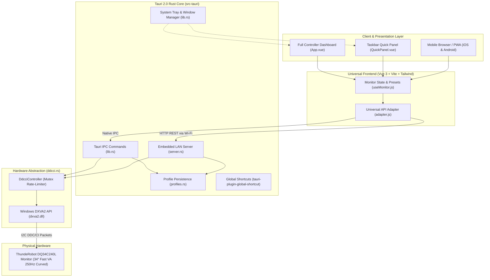

# ThundeRobot DQ34C240L Monitor Control Suite

[](https://github.com/samiulislamsharan/thunderobot-monitor-control/releases/latest)
[-blue?style=for-the-badge&logo=windows)](https://github.com/samiulislamsharan/thunderobot-monitor-control/releases/latest)
[-ea580c?style=for-the-badge&logo=tauri)](https://tauri.app)
[](https://vuejs.org)
[](LICENSE)

A modern, high-performance native desktop application and local Wi-Fi remote to control your **ThundeRobot DQ34C240L 34″ Fast VA 1440p 250Hz Curved Gaming Monitor** directly via hardware DDC/CI commands, completely replacing the awkward physical joystick OSD button.

---

## ⚡ Highlights & Key Features

* **🖥️ Native Windows Desktop App (Tauri 2.0)**:
  * Minimal resource footprint (~40 MB RAM, ~10 MB binary) with instant startup.
  * Direct Windows DXVA2 (`dxva2.dll`) hardware control over DisplayPort / HDMI I2C lines.
* **⚡ Taskbar System Tray Quick Panel**:
  * Left-click the taskbar tray icon to reveal a borderless quick-control panel right above your system tray.
  * Adjust Brightness, Contrast, Overdrive level, and Presets on the fly without interrupting full-screen games.
  * Auto-hides automatically when clicking outside.
* **🖱️ Mouse Wheel Slider Adjustment**:
  * Hover over any slider (Brightness or Contrast) in either the Quick Panel or Main Dashboard and use your mouse wheel for granular adjustments (±2% per tick, ±5% with Shift).
* **📱 Embedded Smartphone Remote over Wi-Fi**:
  * Embedded multi-threaded HTTP server (`tiny_http` + `rust-embed`) inside the binary—**no Python, Uvicorn, or external dependencies required**.
  * Dynamic LAN IP discovery (`192.168.x.x`) with in-app scannable **QR Code** pairing.
  * Progressive Web App (PWA) ready: tap **"Add to Home Screen"** on iOS or Android for a full-screen native mobile experience.
* **🎮 250Hz Gaming Tuner & Factory Presets**:
  * Instant switching between **250Hz Esports**, **Cinema 21:9**, **Night Mode**, and **sRGB Content**.
  * Pixel Overdrive tuning (Levels 0–5), Black Equalizer / Sharpness (`0x3E`), and 1ms MPRT Strobe toggle (`0xE3`).
  * Custom preset snapshots persisted in `%APPDATA%\thunderobot-monitor-control`.

---

## 🏗️ Architecture Overview

The application features a hybrid architecture enabling both native desktop speed and smartphone LAN remote control from a single binary:



---

## 🚀 Installation & Downloads

Download the latest version from the **[Releases Page](https://github.com/samiulislamsharan/thunderobot-monitor-control/releases/latest)**:

| Format | File | Description |
| :--- | :--- | :--- |
| **Setup Wizard** | `thunderobot-monitor-control_<ver>_x64-setup.exe` | Standard Windows installer with desktop and Start Menu shortcuts. |
| **Windows MSI** | `thunderobot-monitor-control_<ver>_x64_en-US.msi` | Windows Installer package suitable for automated enterprise deployment. |
| **Portable** | `thunderobot-monitor-control.exe` | Single standalone executable—run directly without installation. |

---

## 📱 Smartphone Setup (30 Seconds)

1. Connect your phone to the same Wi-Fi router as your PC.
2. In the desktop application header, click **"📱 Phone Remote"**.
3. Scan the displayed **QR Code** with your smartphone camera.
4. *(Optional)* In your phone's browser, tap **"Add to Home Screen"** to install it as an app icon.

---

## 🗺️ Reverse-Engineered DDC/CI VCP Register Map

| VCP Code | Name | Range / Values | Type | Description |
|---|---|---|---|---|
| **0x10** | Luminance | 0 – 100 | Continuous | Backlight brightness |
| **0x12** | Contrast | 0 – 100 | Continuous | Contrast ratio |
| **0x14** | Color Temperature | `0x05`, `0x06`, `0x08`, `0x0B` | Discrete | 6500K Warm, 7500K Normal, 9300K Cool, User RGB |
| **0x16** | Red Gain | 0 – 100 | Continuous | Red channel multiplier |
| **0x18** | Green Gain | 0 – 100 | Continuous | Green channel multiplier |
| **0x1A** | Blue Gain | 0 – 100 | Continuous | Blue channel multiplier |
| **0x6C** | Red Black Level | 0 – 255 | Continuous | Red shadow offset |
| **0x6E** | Green Black Level | 0 – 255 | Continuous | Green shadow offset |
| **0x70** | Blue Black Level | 0 – 255 | Continuous | Blue shadow offset |
| **0xDC** | Picture Mode | `0x00`, `0x02`, `0x03`, `0x05`, `0x07` | Discrete | Standard, Movie, Game, FPS, RTS |
| **0x60** | Input Select | `0x0F`, `0x10`, `0x11`, `0x12` | Discrete | DP1 (250Hz), DP2, HDMI1, HDMI2 |
| **0xAA** | Orientation | `0x01`, `0x02` | Discrete | Landscape (0°), Portrait (90°) |
| **0xD6** | Power Mode | `0x01`, `0x04`, `0x05` | Action | Power On, Standby, Power Off |
| **0x3E** | Sharpness / Black EQ | 0 – 100 | Continuous | Shadow clarity tuning |
| **0x68** | Overdrive | 0 – 5 | Discrete | Pixel response acceleration |
| **0xE3** | MPRT / Aim Assist | 0 – 1 | Toggle | 1ms motion blur strobe |
| **0xAC** | Horizontal Frequency | Read-only | Telemetry | Current line scan frequency |
| **0xAE** | Vertical Frequency | Read-only | Telemetry | Live refresh rate (~250 Hz) |
| **0xC0** | Power-On Hours | Read-only | Telemetry | Total backlight operating hours |
| **0x05** | Reset Luminance | Trigger | Action | Restore factory brightness/contrast |
| **0x08** | Reset Color | Trigger | Action | Restore factory color gains |
| **0x04** | Factory Reset | Trigger | Action | Restore all factory defaults |

---

## 🛠️ Building from Source

### Prerequisites
* Windows 10/11 (x64)
* [Node.js 18+](https://nodejs.org/) & [Rust](https://rustup.rs/)
* Visual Studio 2022 Community with **Desktop development with C++**

### Development Mode
```powershell
# Clone and install dependencies
git clone https://github.com/samiulislamsharan/thunderobot-monitor-control.git
cd thunderobot-monitor-control
npm install
npm --prefix frontend install

# Run native desktop app with live reload
npm run tauri:dev
```

### Production Build
```powershell
# Compiles frontend, embeds assets, and builds installers
npm run tauri:build
```

---

## 🤝 Contributing

We welcome contributions! Please review our **[Contribution Guidelines](CONTRIBUTING.md)** for architecture details, coding conventions, and PR workflows.

---

## 📄 License

This project is licensed under the [MIT License](LICENSE).
