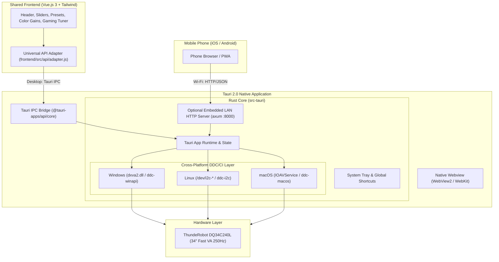

# Feasibility & Implementation Plan: Cross-Platform Desktop App with Tauri 2.0

## Goal Description
Analyze the feasibility and detail the step-by-step roadmap for converting the **ThundeRobot DQ34C240L Monitor Control Suite** into a native, high-performance, cross-platform desktop application using **Tauri 2.0 (Rust)** while reusing the existing **Vue.js 3 + Tailwind CSS** frontend.

### Is It Possible?
**Yes, 100% possible and highly recommended.** Tauri is ideal for low-level hardware utilities:
1. **Tiny Footprint**: Produces a standalone `~15 MB` executable and uses only `~30-50 MB` of RAM (compared to Electron's `~150+ MB` disk and `~200 MB` RAM, or requiring Python and Uvicorn).
2. **Direct OS Hardware Access**: Rust directly interfaces with native OS display and I2C buses:
   - **Windows**: Low-level DXVA2 (`dxva2.dll`) via `windows-sys` or `ddc-winapi`.
   - **Linux**: Direct I2C bus interaction via `/dev/i2c-*` using `ddc-i2c`.
   - **macOS**: Low-level I2C display frame requests via `IOAVService` / `ddc-macos`.
3. **Desktop Superpowers**: Native system tray menu (quick brightness slider from notification area), global keyboard hotkeys (`Ctrl+Alt+Up/Down` to adjust monitor without opening the window), and start-on-boot.
4. **Dual-Mode LAN Remote**: By embedding a tiny Rust HTTP server (`axum` or `tiny_http`) in the Tauri backend, the desktop gets native app speed **while retaining the mobile phone Wi-Fi remote and QR pairing**!

---

## User Review Required

> [!IMPORTANT]
> **Rust Toolchain vs GitHub Cloud Build**:
> 1. Compiling Tauri locally requires the Rust toolchain (`rustup`) and C++ build tools (Visual Studio C++ Build Tools on Windows).
> 2. Alternatively, we can configure a **GitHub Actions CI/CD workflow** that automatically builds `.exe`/`.msi` (Windows), `.deb`/`.AppImage` (Linux), and `.dmg` (macOS) whenever you push a tag or release, requiring zero local Rust setup on your PC!

> [!NOTE]
> **Platform DDC/CI Specifics**:
> - **Windows**: Identical to our current implementation (`dxva2.dll`). Works out-of-the-box with zero configuration.
> - **Linux**: Communicates with `/dev/i2c-*`. Users simply need their user account added to the `i2c` group (`sudo usermod -aG i2c $USER`).
> - **macOS**: External monitors connected via DisplayPort, Thunderbolt, or HDMI work via `IOAVService`. (MacBook built-in liquid crystal displays do not support DDC/CI, but external displays like the ThundeRobot DQ34C240L do).

---

## Architecture Overview



---

## Proposed Changes

### Component 1: Tauri 2.0 Rust Core (`src-tauri/`)

#### [NEW] `src-tauri/Cargo.toml`
Defines Rust dependencies:
```toml
[package]
name = "thunderobot-monitor-control"
version = "1.0.0"
edition = "2021"

[dependencies]
tauri = { version = "2", features = ["tray-icon"] }
tauri-plugin-global-shortcut = "2"
tauri-plugin-autostart = "2"
serde = { version = "1", features = ["derive"] }
serde_json = "1"
tokio = { version = "1", features = ["full"] }
axum = { version = "0.7", optional = true } # Embedded LAN server for phone remote

# Platform specific DDC/CI crates
[target.'cfg(windows)'.dependencies]
windows-sys = { version = "0.52", features = ["Win32_Graphics_Gdi", "Win32_Devices_Display"] }

[target.'cfg(target_os = "linux")'.dependencies]
i2c-linux = "0.1"

[target.'cfg(target_os = "macos")'.dependencies]
core-foundation = "0.9"
```

#### [NEW] `src-tauri/src/ddc/mod.rs`
Unified cross-platform trait for DDC/CI:
```rust
pub trait MonitorDriver: Send + Sync {
    fn enumerate_monitors(&self) -> Result<Vec<MonitorDescriptor>, String>;
    fn get_vcp(&self, monitor_id: &str, code: u8) -> Result<VCPReply, String>;
    fn set_vcp(&self, monitor_id: &str, code: u8, value: u16) -> Result<(), String>;
}
```

#### [NEW] `src-tauri/src/ddc/windows.rs`
Pure Rust implementation of DXVA2 (`GetVCPFeatureAndVCPFeatureReply`, `SetVCPFeature`, `GetNumberOfPhysicalMonitorsFromHMONITOR`). This replaces the Python `ctypes` driver with zero runtime overhead.

#### [NEW] `src-tauri/src/ddc/linux.rs`
Linux `/dev/i2c-*` I2C slave implementation targeting DDC address `0x37`.

#### [NEW] `src-tauri/src/ddc/macos.rs`
macOS `IOAVService` display I2C service wrapper.

#### [NEW] `src-tauri/src/commands.rs`
Tauri commands exposed to the Vue 3 frontend:
- `get_monitor_info`: Retrieves model name, resolution, 250Hz refresh rate, and telemetry.
- `get_all_vcp`: Queries all mapped VCP features.
- `set_vcp(code, value)`: Sets target VCP value with thread-safe rate-limiting.
- `apply_profile(profile_id)`: Applies batch profile.
- `toggle_mprt`, `set_brightness`, `set_contrast`.

#### [NEW] `src-tauri/src/tray.rs`
System Tray menu:
- App indicator icon with quick presets menu (FPS 250Hz, Night Mode, Cinema).
- Quick Brightness sub-slider / presets (+10% / -10%).
- Show/Hide window, Quit.

#### [NEW] `src-tauri/tauri.conf.json`
Configuration for window sizing (optimized for 34″ ultrawide or compact companion window), icons, permissions, and build targets.

---

### Component 2: Frontend Abstraction Layer (`frontend/`)

#### [NEW] `frontend/src/api/adapter.js`
Transparent bridge that detects whether the app is running inside Tauri or in a web browser:
```javascript
const isTauri = typeof window !== 'undefined' && Boolean(window.__TAURI_INTERNALS__);

export async function invokeCommand(cmd, args = {}) {
  if (isTauri) {
    const { invoke } = await import('@tauri-apps/api/core');
    return invoke(cmd, args);
  } else {
    // Fallback to HTTP REST endpoint (for phone browser over LAN)
    const res = await fetch(`/api/${cmd}`, {
      method: 'POST',
      headers: { 'Content-Type': 'application/json' },
      body: JSON.stringify(args)
    });
    return res.json();
  }
}
```

#### [MODIFY] `frontend/src/composables/useMonitor.js`
Route all calls through `invokeCommand()` so the UI works identically whether compiled as a Tauri native desktop app or served over Wi-Fi to a mobile phone.

---

### Component 3: Automated Cross-Platform CI/CD Build (`.github/workflows/`)

#### [NEW] `.github/workflows/tauri-build.yml`
GitHub Actions matrix build that compiles native installers across all 3 platforms on every release tag:
- **Windows**: `.msi` and `.exe` installer (x64)
- **Linux**: `.AppImage` and `.deb` (x64)
- **macOS**: `.dmg` (Universal / Apple Silicon + Intel)

---

## Verification Plan

### Automated Tests
1. **Rust DDC Unit Tests**:
   ```powershell
   cargo test --manifest-path src-tauri/Cargo.toml
   ```
2. **Frontend Adapter Mock Tests**:
   - Verify `adapter.js` handles both Tauri IPC and HTTP fallback cleanly.
3. **Tauri Dev Build Verification**:
   ```powershell
   npm run tauri dev
   ```

### Manual Verification
1. Launch native desktop Tauri window.
2. Verify hardware brightness/contrast adjustments on the **ThundeRobot DQ34C240L**.
3. Press global hotkeys (`Ctrl+Alt+Up` / `Ctrl+Alt+Down`) while in a game to verify brightness changes without leaving the game.
4. Minimize window to system tray; verify tray icon menu functionality.
5. Open phone browser over Wi-Fi and verify smartphone remote still controls the screen simultaneously.
